**Flutter & Mobile App Developer · AWS Certified Cloud Practitioner · Computer Science Undergraduate**

Computer Science undergraduate (7th semester, CGPA 3.60/4.00) specializing in Flutter mobile development, with self-driven full-stack projects spanning real-time sync, offline-first architecture, and backend API integration using Django, FastAPI, Supabase, and Firebase.

AWS Certified Cloud Practitioner with working knowledge of Docker for containerized deployments. Comfortable owning a feature end-to-end, from REST API design and cloud deployment to a polished, responsive UI.

- 🔭 Currently working on **AgentForge** — my final-year project, a virtual software house built from AI agents
- 🌱 Currently learning **DevOps** (Docker, CI/CD, cloud deployment)
- 💼 Flutter Developer intern at **Jeux Developer** (onsite)
- 📫 Reach me at **muhammadawaishassan1@gmail.com**

| Role | Company | Location | Period | What I did |
| --- | --- | --- | --- | --- |
| Mobile App Development Intern | Jeux Developer | Onsite | Present | Building and maintaining Flutter features and integrating APIs under senior developers in a production environment |
| Remote Intern | Rayonix Solutions | Remote | Sep 2025 (6 weeks) | Hands-on exposure to a professional remote work environment and collaborative team workflows |

### 🚀 AgentForge — Final-Year Project
A virtual software house built from AI agents — design, frontend, backend, QA, and deployment services working as microservices over RabbitMQ with a LangGraph orchestrator and human-in-the-loop approval after every stage. Shared project context in PostgreSQL, Docker Compose stack of ~10 containers.
`Python` `FastAPI` `RabbitMQ` `LangGraph` `PostgreSQL` `Docker`

### 🛒 Electronics Installment Management System
Full-stack installment tracking system for an electronics retailer — staff register customers, set up payment plans, and monitor outstanding balances from a single dashboard. FastAPI REST APIs for installment schedules, due-date reminders, and payment history, backed by a normalized PostgreSQL schema.
`Flutter` `Dart` `FastAPI` `PostgreSQL` · [View on GitHub →](https://github.com/Awaishasan/softecSMCApp)

### 🗓️ University Timetable App
Cross-platform Flutter app with Provider state management and a FastAPI backend that returns schedule responses within seconds. Version-based sync checks a CSV version flag and downloads new data only when it changes; offline-first access so students can view their timetable with zero internet connection.
`Flutter` `FastAPI` `Provider` · [View on GitHub →](https://github.com/Awaishasan/cui_time_table)

### 🧑‍💼 Employee Attendance System
Background service that logs employee check-ins every 10 minutes and bulk-inserts records into PostgreSQL, reducing per-event database write overhead. Responsive Flutter dashboard for real-time monitoring of workforce presence and shift timings.
`Flutter` `Django` `PostgreSQL` · [View on GitHub →](https://github.com/Awaishasan/attendance_app)

### 🏬 Enterprise Resource Management System
Backend of an e-commerce web application using Python, Django, and Django REST Framework — REST APIs for user authentication, product management, shopping cart, and order processing.
`Django` `Python` `Django REST Framework` `SQL` · [View on GitHub →](https://github.com/Awaishasan/pepsi_work_flow_system)

### 📩 Excel SMS Sender App
Kotlin Android app that reads an Excel file (phone numbers + messages) and sends bulk SMS through a queue-based foreground service. Fixed long-message failures with multipart SMS sending; phone-number normalization and a reliable send queue.
`Kotlin` `Android` `Excel Import` · [View on GitHub →](https://github.com/Awaishasan/smsSenderApp)

#### Backend

#### Frontend

#### Cloud & DevOps

#### Databases

#### Tools

| Area | What I do |
| --- | --- |
| Mobile development | Flutter apps with GetX / Provider state management, Material UI, offline-first architecture |
| Backend & APIs | REST API design with Django, FastAPI, and Django REST Framework; auth, products, carts, orders |
| Real-time & sync | Real-time sync and version-based sync that downloads data only when it changes |
| Databases | Normalized PostgreSQL schemas, accurate balance calculations, batch inserts to cut write overhead |
| Cloud & deployment | AWS (Cloud Practitioner certified), Docker containerized deployments |
| End-to-end ownership | Owning a feature from REST API design and cloud deployment to a polished, responsive UI |

### 🎓 Education
**Bachelor of Science in Computer Science** — COMSATS University Islamabad, Sahiwal Campus
Sep 2023 – Jul 2027 · CGPA: 3.60 / 4.00

### 📜 Certifications
- **AWS Certified Cloud Practitioner** — Amazon Web Services, Aug 2026
- **AWS Cloud Computing** — DataCamp
- **Git and GitHub** — Coursera, Aug 2025

### 🏆 Achievements
- **SOFTEC Hackathon** — FAST NUCES, Lahore, Apr 2026 — competed in the Mobile App Development track, building a full-stack mobile app prototype (Flutter frontend with backend integration) under a competitive time limit

Have a mobile app idea, an internship or freelance opportunity, or a backend that needs building? My inbox is open.

---

*Built with Flutter, FastAPI, and a lot of learning — always learning, always growing.*

